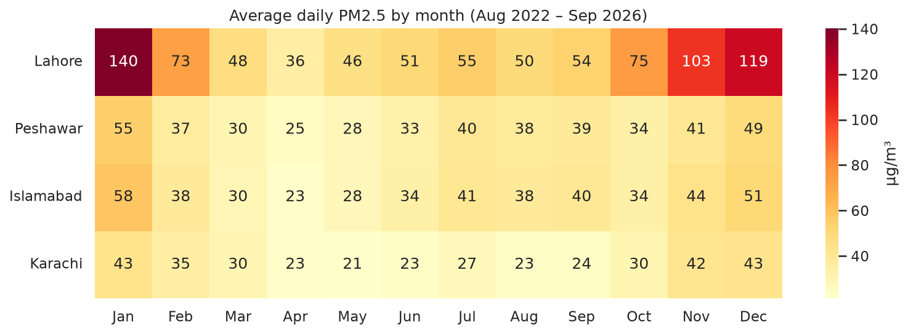
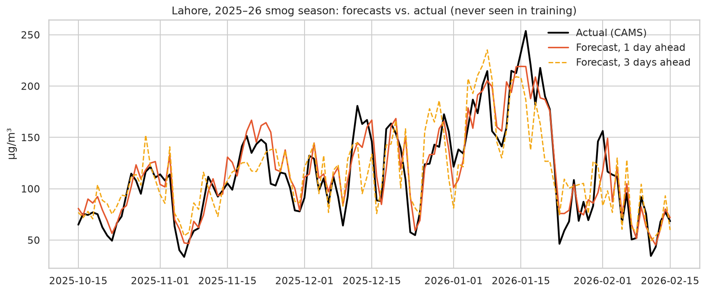
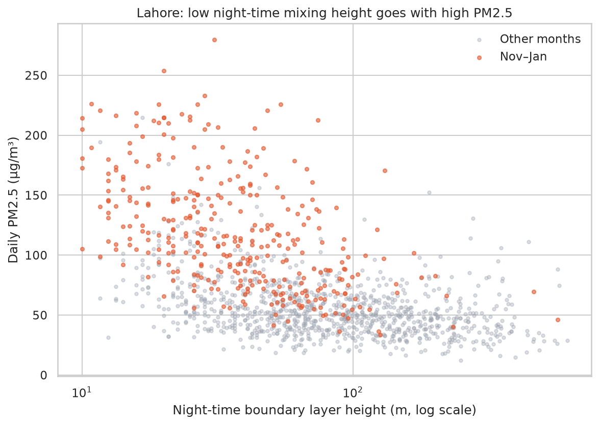

# 🌫️ Pakistan Smog Forecast

**A daily, automatically updated 3-day PM2.5 forecast for Lahore, Peshawar, Islamabad and Karachi, with an honest backtest of how accurate it is.**


[](https://github.com/anascs12/pakistan-smog-forecast/actions/workflows/daily-forecast.yml)

> 🌐 **[Today's forecast (live)](https://anascs12.github.io/pakistan-smog-forecast/)** · 📓 **[Analysis & backtest notebook](notebooks/smog_forecast_analysis.ipynb)**



## Why
Every winter, smog makes Lahore's air among the most polluted in the world. A few days of warning lets schools, hospitals and families plan: keeping children indoors, wearing masks, or avoiding outdoor exercise on the worst days. This project forecasts **daily average PM2.5 one to three days ahead** and publishes the forecast every morning.

## Key findings (August 2022 – September 2026)

| | Finding |
|---|---|
| 🏭 | **Lahore** averages **140 µg/m³ in January**, about 9× the WHO guideline. **52%** of all days are *Unhealthy* or worse, and in November–January **41%** of days reach *Very unhealthy* or *Hazardous*. |
| 🌙 | Smog builds when the **night-time mixing layer collapses** and winds are calm (Lahore: Spearman ρ = −0.54 and −0.49), which is the classic winter temperature inversion. |
| 🎯 | On a period the model never saw (Aug 2025 – Sep 2026), it beats persistence by **15% / 23% / 25%** at 1 / 2 / 3 days. In **smog season the gain rises to 21–31%**. |
| 🌊 | **Karachi** is cleanest; there humid days are *cleaner* (sea breeze), the opposite of the northern cities. |

| Horizon | Model MAE | Persistence MAE | Seasonal-average MAE | Improvement |
|---|---|---|---|---|
| 1 day | **6.4** | 7.6 | 10.7 | 15% |
| 2 days | **8.0** | 10.4 | 10.7 | 23% |
| 3 days | **8.7** | 11.6 | 10.7 | 25% |

<p>


</p>

## How it works

```
Open-Meteo APIs ──▶ hourly PM2.5 (CAMS) + weather (ERA5 archive / live forecast) for 4 cities
      │
      ▼  daily aggregation (≥18 valid hours; feed artifacts removed)
features: PM2.5 today, 1, 2, 6 days ago, 7-day mean · today's and target-day weather
          (night-time mixing height, wind, humidity, temperature, rain) · season · city
      │
      ▼  one gradient-boosting model per horizon, trained on log(PM2.5)
backtest vs. persistence & seasonal average ── time-ordered split at 1 Aug 2025
      │
      ▼  GitHub Action, every day at 06:30 PKT
fetch latest data → forecast → render docs/index.html → commit → GitHub Pages
```

**Choices worth discussing**
- **Leakage-safe split:** training stops where the *target date* reaches 1 August 2025, and every test forecast is issued after it. No shuffling.
- **Strong baselines first:** persistence is hard to beat at 1 day, because pollution changes slowly. The model's value grows at 2–3 days, because it knows the coming weather.
- **Data cleaning:** on 14–15 December 2022, all four cities read about 0.7 µg/m³ in peak smog season. That's a CAMS feed artifact, removed with a plausibility rule and covered by a unit test.
- **Live inputs are honest:** only complete past days count as observed. The API's own CAMS forecast hours are masked so they never leak in as "observations".

## Run it yourself
Requires [uv](https://docs.astral.sh/uv/).

```bash
git clone https://github.com/anascs12/pakistan-smog-forecast.git
cd pakistan-smog-forecast
uv sync
uv run python -m smog.forecast            # today's forecast → docs/index.html
uv run pytest                             # 13 tests
uv run jupyter lab notebooks/             # analysis

# Rebuild from scratch
uv run python -m smog.data                # download 4 years of hourly data
uv run python -m smog.forecast --train    # refit the models
```

## Project structure
```
├── src/smog/
│   ├── data.py       # Open-Meteo client, caching, daily aggregation and data-quality rules
│   ├── model.py      # features, models, baselines, AQI categories, backtest
│   ├── forecast.py   # train final models; issue the live forecast
│   └── page.py       # renders the public forecast page
├── .github/workflows/daily-forecast.yml   # runs tests + forecast every morning
├── models/forecaster.joblib
├── notebooks/smog_forecast_analysis.ipynb
├── data/processed/   # daily data, backtest scores and predictions
├── docs/             # the live page (GitHub Pages)
└── tests/
```

## Limitations
- PM2.5 comes from the **CAMS global model**, not ground monitors. It follows the seasonal pattern and daily swings but **underestimates extreme peaks**, so real conditions can be worse.
- The backtest uses observed weather for the target day (a perfect weather forecast); live accuracy will be somewhat lower, especially at 3 days.
- City-wide daily averages hide hotspots and hourly peaks.
- This is a student data-science project, **not an official health advisory**. Follow the Punjab and Khyber Pakhtunkhwa Environmental Protection Agencies.

## Credits
Weather and air-quality data from [Open-Meteo](https://open-meteo.com/) (CC BY 4.0), based on the Copernicus Atmosphere Monitoring Service and ERA5 reanalysis.

Code: MIT licence. Built by **[Anas Khan](https://www.linkedin.com/in/anas-khan-ds/)**, Data Science student at IMSciences Peshawar.
